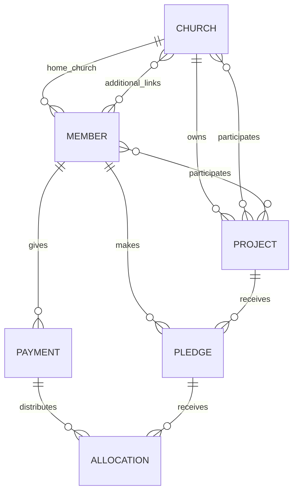

# Mobile implementation notes

The mobile app is being built first. The web application, backend, authentication, server-side permissions and synchronized audit log are future work. Local data is a device-only working dataset; it is not an authenticated or multi-user system.

## Assumptions

- Money is whole UGX; dates use the Africa/Kampala calendar.
- Daily periods are calendar days, weeks start Monday, and months are calendar months. A period remains due now until it ends; unpaid earlier periods are overdue.
- An unrestricted payment fills the oldest unpaid period across a member's pledges. A project-scoped payment only covers that project's pledges. Existing locally saved pledge-specific payments retain that restriction.
- A pause suppresses every calendar period it touches. Resuming partway through a period starts demand again in the following period. A changed amount starts a new version; a period already covered by the previous version retains its original amount.
- The church recorded on a payment is the member's home church at payment time. Payments are voided with a reason instead of edited.
- The prompt's first worked example has a conflict: after ten overdue days, the eleventh day is also due now. Under oldest-first allocation, 15,000 clears the ten overdue days and today, leaving four strictly future days of advance.
- Allocation is bounded to 10,000 generated periods per member to keep mobile processing responsive; the UI rejects changes that exceed the limit.

## Local entity relationships

The local TypeScript record types are in `src/features/contributions/model.ts`. Allocation rows are derived from pledges and payments, not manually entered. This is a frontend data model; the future database schema, role enforcement and audit records must be designed and enforced in the backend.

`rebuildAllocations({ memberId, pledges, payments, asOf, dueBasis? })` returns period rows, payment-to-period allocations, unallocated amounts and totals for overdue, due now, advance, unallocated and paid. It is pure and can be tested independently with `npm test -- --runInBand --watchman=false`.
